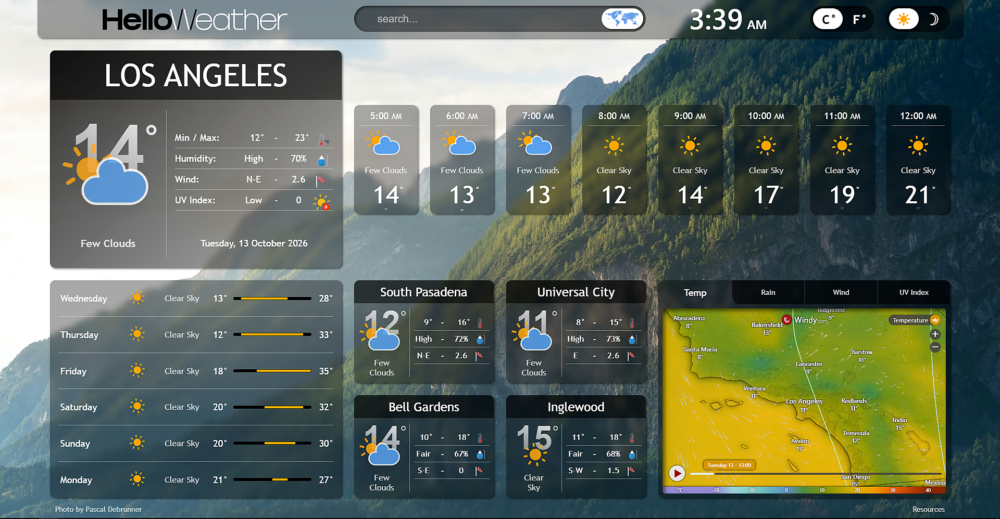
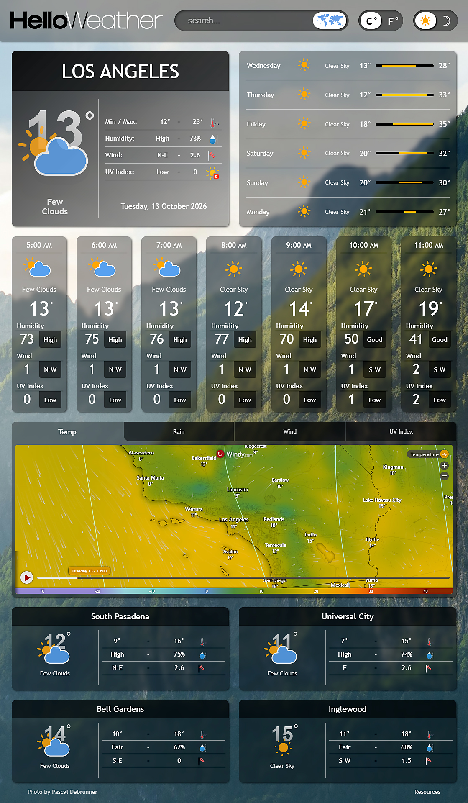
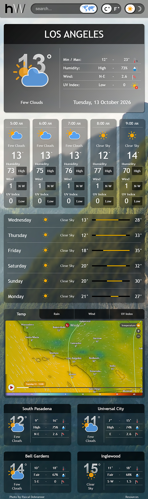
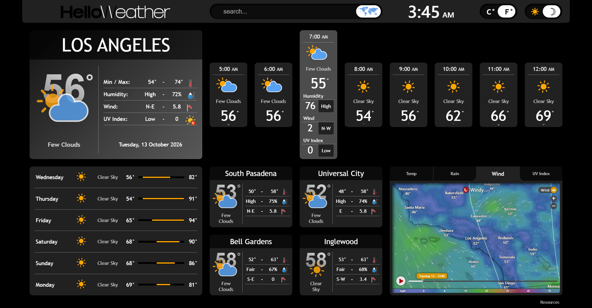

# Hello Weather Dashboard

A responsive weather dashboard built with vanilla HTML, CSS and JavaScript, using the OpenWeatherMap API.

**Live demo:** [helloweather.info](https://helloweather.info)

## Stack

HTML, CSS, JavaScript, OpenWeatherMap API

## Features

- Built a responsive single-page dashboard in vanilla JavaScript, making 6 API calls to 3 different endpoints to provide geocoding and current, hourly, daily, and nearby locations weather data, with async/await.
- Implemented imperial/metric unit switching, a light/dark theme, and backgrounds that follow the weather and time of day, with animated SVG indicators for conditions, wind, and UV index.
- Designed a touch-friendly layout for desktop, tablet, and phone, with an embedded interactive weather map.
- Added client-side request limiting (sessionStorage and localStorage) to protect the API quota.
- Secured the OpenWeather API key behind a Cloudflare Worker proxy: the frontend calls the Worker, which adds the key server-side as an encrypted secret, forwards only the three endpoints the app uses, and allows browser access only from approved origins (CORS).

